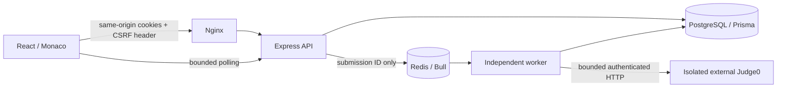

# Architecture

The existing Node stack was retained: Express replaces FastAPI, Prisma migrations replace Alembic, Bull replaces Celery, and Vite/React retains the working frontend instead of a Next.js rewrite. Database IDs remain CUID strings to preserve existing relations.

Submission creation validates publication and Python language, locks the user row for concurrency admission, persists Pending, and enqueues the stable submission ID as the job ID. Queue failure persists Failed and returns HTTP 503. Redis never receives source code, tests, or provider credentials in job payloads.

The worker loads authoritative tests and limits from PostgreSQL, executes each case through the provider interface and persists results, verdict and metrics transactionally. Per-user row locks and a conditional terminal update prevent duplicate statistics credit. Bull coordinates per-job delivery and stalled-job recovery. Jobs have a 15-minute deadline; reconciliation fails records older than 20 minutes so a queue outage cannot leave them pending indefinitely once the worker is restored. A sustained database outage still requires operator recovery.

Queue status (Pending/Running/Completed/Failed) is separate from verdict. The legacy status column is kept for frontend compatibility. Output comparison normalizes CRLF and trailing spaces/tabs at each line and trailing newlines; it preserves leading spaces, interior spaces, punctuation and numeric values. All configured tests are evaluated. Runtime is the mean per-test milliseconds, memory is maximum KB. Percentiles remain null because no trustworthy comparative measurement exists.

Run accepts empty custom input, stores actual stdout separately and never changes problem completion or leaderboard credit. Submit ignores no client-provided expected output: unexpected fields and custom input on a judged submission are rejected. Public result serialization strips hidden case IDs, stdout, expected output and diagnostics, since user code can echo private stdin. WebSocket submission rooms were removed; the UI polls persistent owner-authorized results with bounded backoff. Existing public contest sockets are separate optional functionality.

The API and worker are independently runnable. Worker concurrency bounds local processing. A Redis sorted-set semaphore separately enforces GLOBAL_EXECUTION_CONCURRENCY across worker replicas. Leases expire after twenty minutes to recover crashed workers, and every job has a shorter execution deadline. Capacity admission waits at most four minutes and fails explicitly.
