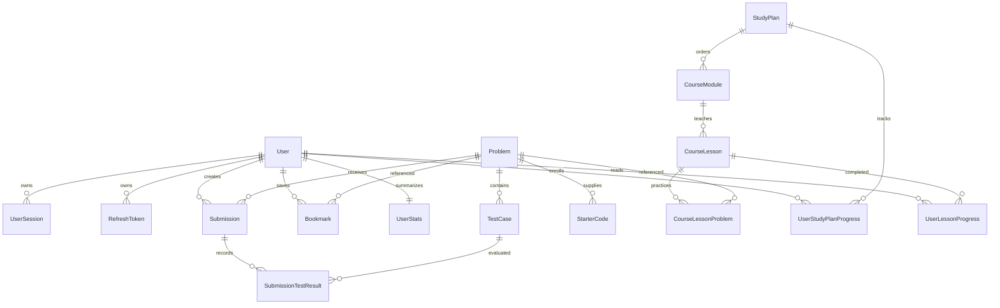

# Database

Prisma schema: `backend/prisma/schema.prisma`. PostgreSQL is authoritative; Redis is coordination and temporary reset-token storage.

The baseline migration captures the inherited schema. The judging migration adds mode, custom run output, separate queue state/verdict, processing timestamps, output-limit status, bookmarks and admin audit events. Old terminal submissions are backfilled. Sessions created under the old authentication design are revoked. Historic Run/Submit mode cannot be inferred; it defaults to Submit, so historical statistics should be reviewed before relying on them.

Foreign keys and uniqueness enforce ownership relations. Problem slug/number, username/email, refresh-token hash and bookmark user/problem pairs are unique. User, problem, submission date and queue-state indexes support common queries. Timestamps are stored as UTC instants; streak days use UTC.

Unpublishing is a soft operation preserving submission history. Editing test cases replaces their rows and cascades prior per-test results; stored verdicts remain. User deletion cascades private submissions, profile, tokens, sessions and bookmarks. Audit events retain an actor ID as an opaque historical identifier after deletion; apply an organization-specific audit-retention policy.

Run results never award solved credit. The leaderboard derives distinct active problem IDs from accepted judged submissions, excludes administrators, banned accounts and private profiles, and breaks ties by username. Retention strips old source, run input/output and test diagnostics while retaining verdicts and aggregate metrics. Run the explicit retention command regularly.

The course migration extends StudyPlan with publication state and ordered modules/lessons. Module slugs are unique per course; lesson slugs per module. Reading completion is unique per user/lesson. Admin edits preserve stable IDs; removing lessons cascades their completion records. User deletion removes enrollment and reading progress. Course API problem progress is derived from distinct accepted non-Run submissions, rather than trusting the legacy cached enrollment counters. Lesson resources are HTTPS links in JSON and do not count as verified solves.

Problem provenance stores source name/URL/ID, license and attribution. Source-name/source-ID pairs are unique when a source ID is supplied. Admin imports create drafts transactionally; publication still requires separate reference verification. Chat history is not stored in the database.
